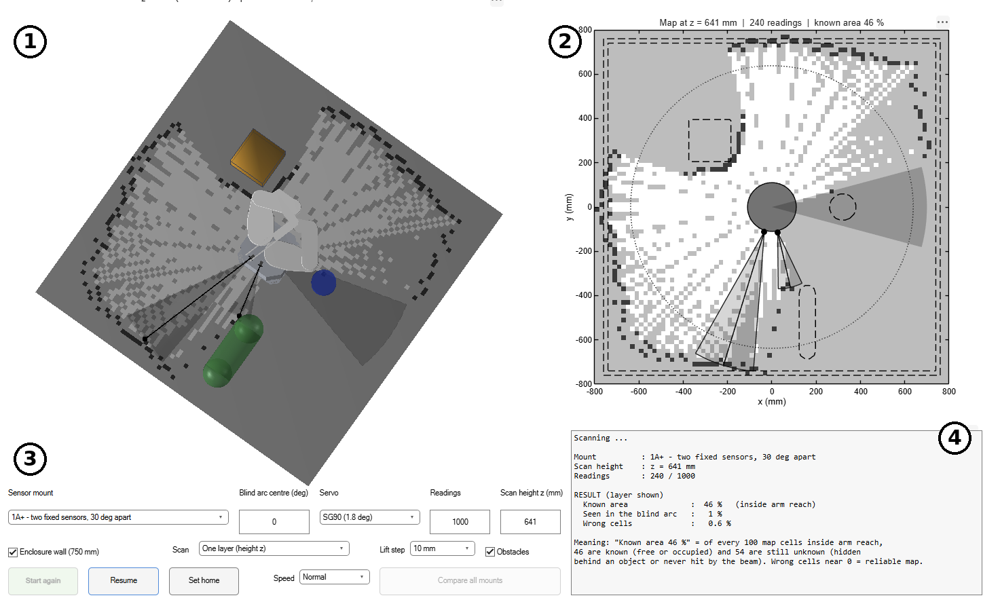
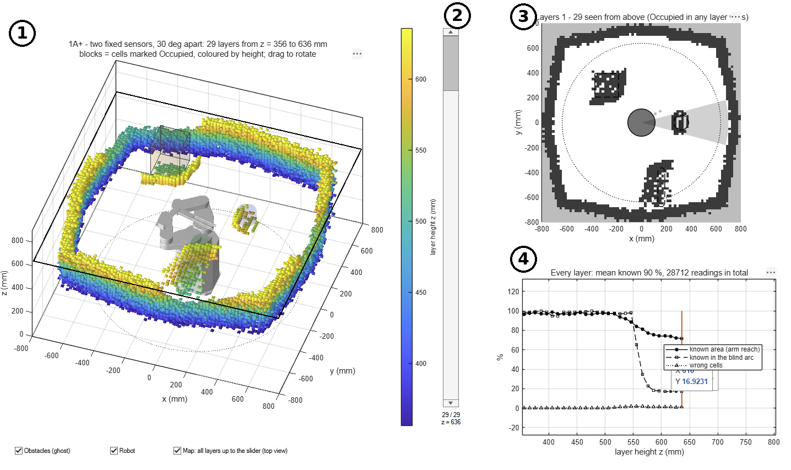

# FBD Mapping – sensor mount test and 3D layered mapping

MATLAB simulation for the **FBD robot arm**: it shows how a VL53L0X (TOF200C)
distance sensor maps the obstacles around the robot, and compares different
ways of mounting the sensor.

The robot turntable can only rotate **330°**, so a **30° "blind arc"** is never
faced directly. The program tests four sensor mounts and shows which ones can
still see into that blind arc.

| Mount | Description |
|-------|-------------|
| **1A**  | One sensor fixed on the turntable |
| **1A+** | Two fixed sensors, 30° apart (recommended) |
| **2B**  | Sensor on a servo mounted on the turntable |
| **2C**  | Sensor on a 360° servo on top of the end-effector block |



---

## 1. Requirements

- MATLAB **R2016b or newer** (no toolbox needed).
- The files of this repository:

```
FBD_Mapping/
├── prm_robot_arm.m   <- the whole program (one file)
├── mesh/             <- 3D CAD parts of the robot (.stl)
└── docs/             <- screenshots for this README
```

The robot model is also stored inside `prm_robot_arm.m`, so the program still
runs without the `mesh/` folder. If `mesh/` is present, the `.stl` files there
are used instead (handy when the CAD changes: export new STL files and replace
them).

## 2. Download (clone) the project

The repository is public: anyone can download it, no GitHub account needed.
Pick **one** of the four ways below.

### Option A – Download ZIP (simplest, nothing to install)
1. Open https://github.com/Ibuonphuqa795/FBD_Mapping
2. Click the green **Code** button → **Download ZIP**.
3. Unzip it.

A ZIP does not update itself: download it again to get a newer version.

### Option B – Clone inside MATLAB (MATLAB R2023b or newer)
Type in the MATLAB Command Window:
```matlab
gitclone("https://github.com/Ibuonphuqa795/FBD_Mapping.git", "FBD_Mapping");
cd FBD_Mapping
```
To get the newest version later: right-click in the **Current Folder** panel →
**Source Control** → **Pull**.

### Option C – GitHub Desktop
1. Install GitHub Desktop: https://desktop.github.com
2. **File** → **Clone repository** → tab **URL** → paste
   `https://github.com/Ibuonphuqa795/FBD_Mapping.git`
3. Choose a local folder → **Clone**.

To get the newest version later: **Fetch origin** → **Pull origin**.

### Option D – Command line (Git installed)
```bash
git clone https://github.com/Ibuonphuqa795/FBD_Mapping.git
cd FBD_Mapping
```
To get the newest version later:
```bash
git pull
```

> Cloning only lets you download and run the code. To push changes to this
> repository you must be added as a collaborator (repository **Settings** →
> **Collaborators**).

## 3. Quick start

1. Open MATLAB and set the **Current Folder** to `FBD_Mapping`.
2. Run:
   ```matlab
   prm_robot_arm
   ```
3. The FBD robot window opens. In the right-hand panel:
   - **Mount test 360** → test the sensor mounts at one height.
   - **Mapping 3D** → layered scan: scan, lift, scan again … (see section 5).

To close every window of the program:
```matlab
prm_robot_arm kill
```

## 4. Mount test (one height)

1. Choose the **Sensor mount** (1A, 1A+, 2B or 2C).
2. Optional settings:
   - **Blind arc centre (deg)** – direction of the 30° blind arc.
   - **Servo** – SG90, MG90S or ideal (only used by 2B).
   - **Readings** – number of distance readings.
   - **Scan height z (mm)** – height of the scanned slice.
   - **Enclosure wall** – adds a wall around the robot at 750 mm.
3. Press **Start**. The turntable turns, the servo moves (if any), the beam is
   drawn and the map fills in. **Pause** / **Set home** stop the scan,
   **Speed** changes the animation speed.
4. Read the result box:
   - **Known area** – of every 100 map cells inside arm reach, how many are
     already known (free or occupied). The rest are hidden behind objects.
   - **Seen in the blind arc** – the same, inside the 30° blind arc.
   - **Wrong cells** – cells that disagree with the real obstacles
     (close to 0 = reliable map).
5. **Compare all mounts** runs all four mounts with the same settings
   (3 repeats each) and lists the results. They are also saved as
   `mount_compare.mat` and in the variable `mountCompare`.

Map colours: **white** = free, **light grey** = unknown, **dark** = occupied,
dashed lines = real obstacles.

## 5. Layered 3D mapping

Press **Mapping 3D** (or set **Scan** to *Layers: lift d1 step by step*).

- Each layer = sweep the turntable, then lift the sensor by the **Lift step**
  (5, 10 or 20 mm) and sweep again, until the top of the lift.
- Finished layers stay in the 3D view as small blocks coloured by height
  (blue = low, yellow = high), like the layer preview of a 3D-printer slicer.
- When the scan ends:
  - drag the **Layer** slider to show the layers one by one;
  - tick **Map: all layers up to the slider** for a top view of all layers;
  - **Show chart / Show info** switches between the chart of every layer and
    the text results.
- The results are stored in the variable `mountLayers`.



## 6. Obstacles

The obstacles are the ones set in the **Obstacles** panel of the main robot
window (sphere, box, cylinder, capsule, ellipsoid, cone). Change them there,
then open the mount test / mapping again.

## 7. Updating the code

**With GitHub Desktop (easiest)**
1. *File → Clone repository* → `Ibuonphuqa795/FBD_Mapping`.
2. Edit or replace `prm_robot_arm.m` in that folder.
3. In GitHub Desktop: write a short summary → **Commit to main** → **Push origin**.

**With the command line**
```bash
git add prm_robot_arm.m mesh
git commit -m "Describe the change"
git push
```

Backup files (`.bak`, `.asv`) and results (`.mat`) are ignored automatically
(see `.gitignore`).

## 8. Notes

- This is a simulation: it does not include colour, shine or ambient light,
  which make the real sensor less accurate. Use the numbers to **compare**
  mounts, not as real measurements.
- Sensor model: VL53L0X, 25° cone, 40 – 1200 mm, 3 readings per direction
  (median), 20 mm map cells.
